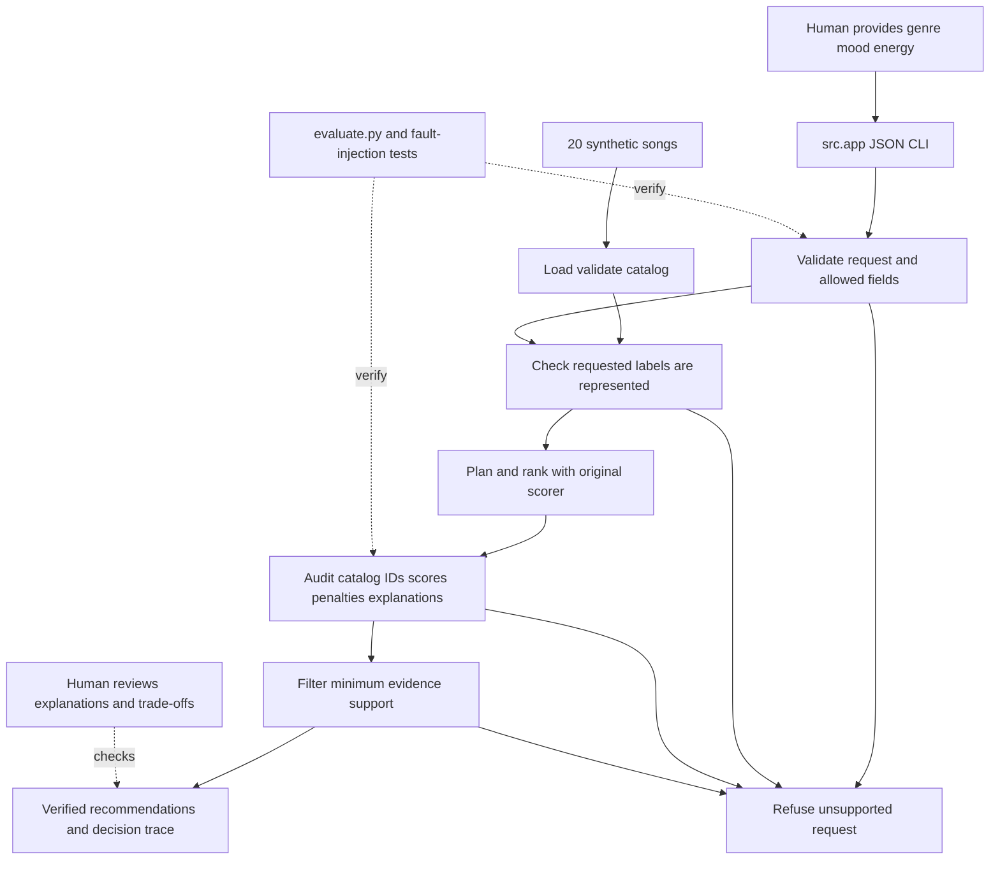

# VibeGuide: Reliable Music Recommendations

AI110 Applied AI System final project. VibeGuide extends **Project 3: Music Recommender Simulation (VibeFinder)**. The original project loaded 20 synthetic song records and used genre, mood, and energy weights to produce explained top-K recommendations. It supported three scoring modes and an optional artist diversity penalty, but it would return a list even when a requested genre was absent from the catalog.

Original project: https://github.com/r7rudy37-sudo/ai110-module3show-musicrecommendersimulation-starter

## What Changed and Why

The new feature is an **integrated reliability mechanism**, one of the permitted final-project AI features. Every request now goes through explicit input validation, catalog-label coverage checks, a planning and ranking step, an output audit, and a minimum-support filter. Unsupported requests produce a refusal with no recommendations. The evaluation harness is an additional check, not a substitute for guardrails in the main application.

This is a deterministic content-based AI simulation. It does not call an LLM, train a model, use retrieval-augmented generation, or claim to understand a listener's actual emotions. All recommendations and explanations come from the local synthetic catalog and explicit scoring rules.

## Architecture

The Mermaid source is in [diagrams/architecture.mmd](diagrams/architecture.mmd).



Data flow: the CLI parses one JSON object; the assistant checks it against the validated catalog; the original recommender scores every track; the audit independently recomputes scores and checks original catalog records; only supported records are released. Humans can inspect the exact reasons and choose whether they want the songs. Evaluation checks the same end-to-end assistant.

## Setup, Run, and Test

Python 3.9+ is supported. Runtime uses only the standard library. No API key, network access, payment, or account is needed to run it.

```bash
python3 -m venv .venv
source .venv/bin/activate
python -m pip install -r requirements.txt
python -m src.app --request '{"genre":"pop","mood":"happy","energy":0.8}'
python evaluate.py
python -m pytest -q
```

On Windows activate with `.venv\Scripts\activate`. Run commands from the repo root. The original baseline is still available with `python -m src.main --profile all`. `--catalog PATH` selects a local CSV with the same schema. `--trace-file evidence/my-run.json` saves one full response locally. The app exits with code 1 for malformed JSON or catalog/configuration errors; a deliberate refusal is a successful, handled request and exits with code 0.

## End-to-End Examples: Actual Input and Output

### 1. Happy pop

```text
$ python -m src.app --request '{"genre": "pop", "mood": "happy", "energy": 0.8}'
{
  "status": "ok",
  "message": "Rule-based recommendations from the synthetic catalog; support is not a probability of enjoyment.",
  "recommendations": [
    {
      "id": 17,
      "title": "Weekend Skyline",
      "artist": "Neon Echo",
      "genre": "pop",
      "mood": "happy",
      "score": 3.99,
      "base_score": 3.99,
      "support": 0.9975,
      "explanation": "genre match (+2.00); mood match (+1.00); energy gap 0.01 (+0.99)"
    },
    {
      "id": 1,
      "title": "Sunrise City",
      "artist": "Neon Echo",
      "genre": "pop",
      "mood": "happy",
      "score": 3.18,
      "base_score": 3.98,
      "support": 0.995,
      "explanation": "genre match (+2.00); mood match (+1.00); energy gap 0.02 (+0.98); repeated artist (-0.80)"
    },
    {
      "id": 5,
      "title": "Gym Hero",
      "artist": "Max Pulse",
      "genre": "pop",
      "mood": "intense",
      "score": 2.87,
      "base_score": 2.87,
      "support": 0.7175,
      "explanation": "genre match (+2.00); energy gap 0.13 (+0.87)"
    }
  ],
  "trace": [
    {
      "step": "validate",
      "result": "valid explicit preferences"
    },
    {
      "step": "plan",
      "result": "score 20 catalog records using genre-first"
    },
    {
      "step": "rank",
      "result": "20 scored candidates; artist penalty 0.8"
    },
    {
      "step": "audit",
      "result": "IDs, records, scores, penalties, and explanations verified"
    },
    {
      "step": "filter",
      "result": "3 results meet support threshold 0.7"
    }
  ]
}
```

### 2. Chill lofi

```text
$ python -m src.app --request '{"genre": "lofi", "mood": "chill", "energy": 0.35}'
{
  "status": "ok",
  "message": "Rule-based recommendations from the synthetic catalog; support is not a probability of enjoyment.",
  "recommendations": [
    {
      "id": 4,
      "title": "Library Rain",
      "artist": "Paper Lanterns",
      "genre": "lofi",
      "mood": "chill",
      "score": 4.0,
      "base_score": 4.0,
      "support": 1.0,
      "explanation": "genre match (+2.00); mood match (+1.00); energy gap 0.00 (+1.00)"
    },
    {
      "id": 16,
      "title": "Soft Desk Lamp",
      "artist": "LoRoom",
      "genre": "lofi",
      "mood": "chill",
      "score": 3.98,
      "base_score": 3.98,
      "support": 0.995,
      "explanation": "genre match (+2.00); mood match (+1.00); energy gap 0.02 (+0.98)"
    },
    {
      "id": 2,
      "title": "Midnight Coding",
      "artist": "LoRoom",
      "genre": "lofi",
      "mood": "chill",
      "score": 3.13,
      "base_score": 3.93,
      "support": 0.9824999999999999,
      "explanation": "genre match (+2.00); mood match (+1.00); energy gap 0.07 (+0.93); repeated artist (-0.80)"
    }
  ],
  "trace": [
    {
      "step": "validate",
      "result": "valid explicit preferences"
    },
    {
      "step": "plan",
      "result": "score 20 catalog records using genre-first"
    },
    {
      "step": "rank",
      "result": "20 scored candidates; artist penalty 0.8"
    },
    {
      "step": "audit",
      "result": "IDs, records, scores, penalties, and explanations verified"
    },
    {
      "step": "filter",
      "result": "3 results meet support threshold 0.7"
    }
  ]
}
```

### 3. Intense rock

```text
$ python -m src.app --request '{"genre": "rock", "mood": "intense", "energy": 0.9}'
{
  "status": "ok",
  "message": "Rule-based recommendations from the synthetic catalog; support is not a probability of enjoyment.",
  "recommendations": [
    {
      "id": 3,
      "title": "Storm Runner",
      "artist": "Voltline",
      "genre": "rock",
      "mood": "intense",
      "score": 3.99,
      "base_score": 3.99,
      "support": 0.9975,
      "explanation": "genre match (+2.00); mood match (+1.00); energy gap 0.01 (+0.99)"
    },
    {
      "id": 15,
      "title": "After the Storm",
      "artist": "Voltline",
      "genre": "rock",
      "mood": "intense",
      "score": 3.18,
      "base_score": 3.98,
      "support": 0.995,
      "explanation": "genre match (+2.00); mood match (+1.00); energy gap 0.02 (+0.98); repeated artist (-0.80)"
    }
  ],
  "trace": [
    {
      "step": "validate",
      "result": "valid explicit preferences"
    },
    {
      "step": "plan",
      "result": "score 20 catalog records using genre-first"
    },
    {
      "step": "rank",
      "result": "20 scored candidates; artist penalty 0.8"
    },
    {
      "step": "audit",
      "result": "IDs, records, scores, penalties, and explanations verified"
    },
    {
      "step": "filter",
      "result": "2 results meet support threshold 0.7"
    }
  ]
}
```

Rock returns two supported tracks instead of padding the list with unrelated music to reach three.

## Guardrail Demonstration and Before/After

```text
$ python -m src.app --request '{"genre": "metal", "mood": "happy", "energy": 0.8}'
{
  "status": "refused",
  "message": "No catalog evidence for genre: metal",
  "recommendations": [],
  "trace": [
    {
      "step": "validate",
      "result": "valid explicit preferences"
    },
    {
      "step": "refuse",
      "result": "No catalog evidence for genre: metal"
    }
  ]
}
```

Before: the Project 3 scorer returned Weekend Skyline, Sunrise City, Rooftop Lights for a request for metal, even though the catalog contains no metal tracks. After: VibeGuide checks label coverage and refuses that request with an empty result list. [evidence/before-after.json](evidence/before-after.json) contains the same input and both real outputs. This prevents an unsupported list, rather than merely attaching a warning to it.

## Reliability and Evaluation

A support score is the original weighted score divided by the maximum possible score for the selected mode. It is **not a calibrated probability, model confidence, or predicted enjoyment**. The default threshold is 0.70. Artist penalties affect selection priority but do not change the evidence-support calculation. Support is filtered at full precision; display values are rounded only where appropriate.

The output audit checks that every song ID exists, no ID is repeated, every song record equals the source catalog, the score equals a fresh calculation with the proper artist penalty, and the explanation exactly matches the scoring contributions. If any check fails, the whole request refuses to release results. Tests inject an invented ID, changed title, incorrect score, false explanation, and duplicate song to verify that the audit fails closed.

Actual predefined evaluation:

```text
PASS | happy pop | ok | 3 recommendations
PASS | chill lofi | ok | 3 recommendations
PASS | intense rock | ok | 2 recommendations
PASS | missing inputs | refused | 0 recommendations
PASS | unknown genre | refused | 0 recommendations
PASS | weak combined match | refused | 0 recommendations
PASS | invalid energy | refused | 0 recommendations
PASS | unknown field | refused | 0 recommendations
Summary: 8/8 passed; deterministic replay checked for every case.
```

The eight cases test three genres, missing inputs, unknown genre, an unsupported combination, an invalid energy value, and an unexpected field. Each case is replayed to check deterministic behavior. Structured input, expected behavior, observed output, and pass/fail values are committed in [evidence/evaluation.json](evidence/evaluation.json).

Actual automated tests:

```text
..........................................                               [100%]
42 passed in 0.08s
```

These results establish the documented behavior on this small test set; they do not establish real-world recommendation accuracy.

## Design Decisions

- Keep the original scorer and its explanations rather than introduce a second ranking implementation.
- Require genre, mood, and energy explicitly instead of silently guessing intent from free text.
- Refuse unknown labels and low-support combinations rather than always fill the requested K slots.
- Recompute output facts before release; do not trust an explanation merely because it sounds plausible.
- Use local JSON decision traces and no external telemetry. No private user history is stored by default.

## Reflection, Ethics, and Portfolio

The complete graded reflection is in [model_card.md](model_card.md), including AI collaboration, one accepted design and one revised alternative, limitations, misuse, and future improvements. [ai_interactions.md](ai_interactions.md) links the committed action traces. [presentation.md](presentation.md) provides a timed six-minute presentation and demo outline.

This portfolio project demonstrates an ability to evolve an explainable baseline into a more responsible workflow: identify when inputs are unsupported, make intermediate decisions inspectable, test failures deliberately, and document the practical limits of passing tests. It remains a classroom prototype; a production system would need consented data, human preference evaluation, and stronger catalog coverage.
